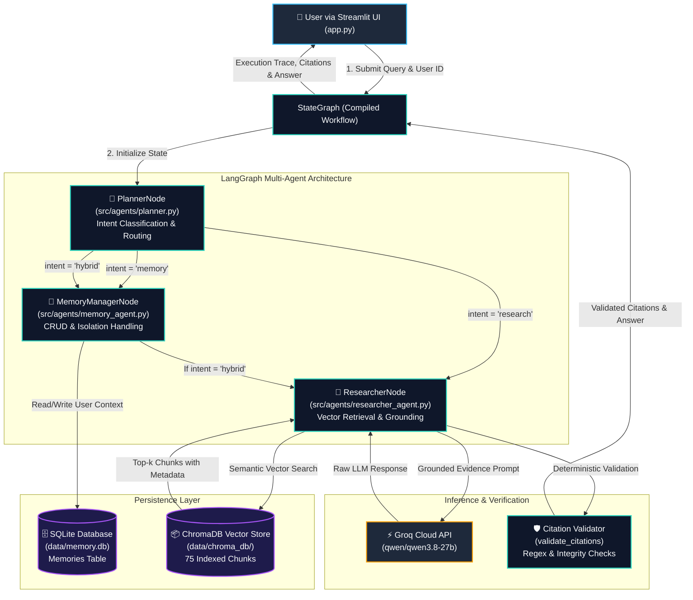

# Asterline Research Assistant: System Architecture & Design

This document details the architectural design, agent state machine, data models, retrieval mechanisms, citation validation, and temporal conflict resolution strategies implemented in the Asterline Research Assistant.

---

## 1. System Architecture Diagram



---

## 2. Core Agent Roles & Responsibilities

The system decouples decision-making, state management, and retrieval synthesis across three specialized nodes:

### 1. Planner Node (`src/agents/planner.py`)
- **Primary Responsibility:** Classifies the user's intent and determines the downstream execution path.
- **Classification Categories:**
  - `memory`: Inquiries or commands dealing exclusively with storing, recalling, updating, or clearing personal user preferences (e.g. *"Remember that my preferred export format is Parquet"* or *"What is my preferred export format?"*).
  - `research`: Inquiries requiring grounding from Asterline's operational knowledge base (e.g. *"What is the contractual monthly uptime SLA for Enterprise customers?"*).
  - `hybrid`: Compound inquiries that combine personal context with company research (e.g. *"Remember that my tier is Enterprise, and tell me our monthly SLA uptime"*).
- **Execution Output:** Injects `intent`, `action`, `key`, `value`, `rationale`, and updates `execution_trace = ['planner']`.

### 2. Memory Manager Node (`src/agents/memory_agent.py`)
- **Primary Responsibility:** Executes user-scoped personal memory operations through the persistent SQLite store (`SQLiteMemoryStore`).
- **Supported Operations:**
  - `store`: Saves or updates a key-value memory for the current `user_id`.
  - `recall`: Retrieves a specific memory or lists all memories for the current `user_id`.
  - `forget`: Deletes a specific memory key.
  - `clear`: Deletes all stored memories for the current `user_id`.
- **User Scoping:** Guarantees that every database operation is parameterized by `user_id`, enforcing strict multi-tenant isolation.
- **Hybrid Flow:** In hybrid queries, the Memory Manager writes the new preference to SQLite, populates `memories[user_id]` into the shared state, and passes control to the Researcher Node.

### 3. Researcher Node (`src/agents/researcher_agent.py` & `src/researcher.py`)
- **Primary Responsibility:** Performs semantic retrieval, injects temporal and version metadata into evidence prompts, synthesizes grounded answers via Groq, and deterministically validates citations.
- **Pipeline:**
  1. **Query Augmentation:** Augments the user query with relevant personal context from `state['memories']` if present (e.g. current tier).
  2. **Vector Retrieval:** Queries ChromaDB for the top-5 most relevant chunks using cosine similarity.
  3. **Evidence Structuring:** Formats chunks with explicit document metadata:
     - `Chunk ID` (e.g. `retention:0`)
     - `Document Title` (e.g. `Data retention policy`)
     - `Published Date` (e.g. `2026-01-15`)
     - `Version` (e.g. `2`)
  4. **Prompt Enforcement:** Instructs the LLM to adhere to the knowledge base, resolve conflicting documents chronologically, and format all citations as `[chunk_id] (Title)`.
  5. **Citation Verification:** Runs deterministic verification on the generated output before finalizing state.

---

## 3. LangGraph State Machine & Conditional Routing

### Shared State Definition (`src/agents/state.py`)

All nodes read from and write to a centralized, typed state container:

```python
class AgentState(TypedDict):
    query: str                       # User input query
    user_id: str                     # Unique user identifier
    intent: str                      # 'research' | 'memory' | 'hybrid'
    action: Optional[str]            # 'store' | 'recall' | 'forget' | 'clear' | 'list'
    memory_key: Optional[str]        # Memory key for CRUD operations
    memory_val: Optional[str]        # Memory value for store operations
    memories: Dict[str, str]         # User's active memories
    retrieved_chunks: List[Dict]     # Top-k retrieved chunks from ChromaDB
    citations: List[Dict]            # Extracted and validated citations
    answer: str                      # Final generated answer
    execution_trace: List[str]       # Chronological list of visited node names
    error: Optional[str]             # Error messages if failure occurs
```

### Graph Topology & Routing Logic (`src/agents/graph.py`)

```python
workflow = StateGraph(AgentState)

# Register Nodes
workflow.add_node("planner", planner_node)
workflow.add_node("memory_manager", memory_manager_node)
workflow.add_node("researcher", researcher_node)

# Entrypoint
workflow.set_entry_point("planner")

# Conditional Routing from Planner
workflow.add_conditional_edges(
    "planner",
    route_after_planner,
    {
        "memory_manager": "memory_manager",
        "researcher": "researcher",
    }
)

# Conditional Routing from Memory Manager
workflow.add_conditional_edges(
    "memory_manager",
    route_after_memory,
    {
        "researcher": "researcher",
        END: END,
    }
)

workflow.add_edge("researcher", END)
```

#### Routing Table:

| Detected Intent | Planner Transition | Memory Manager Transition | Final Node Trace |
| :--- | :--- | :--- | :--- |
| **`memory`** | &rarr; `memory_manager` | &rarr; `END` | `['planner', 'memory_manager']` |
| **`research`** | &rarr; `researcher` | — | `['planner', 'researcher']` |
| **`hybrid`** | &rarr; `memory_manager` | &rarr; `researcher` | `['planner', 'memory_manager', 'researcher']` |

---

## 4. ChromaDB Retrieval Pipeline

### Vector Indexing (`src/indexer.py`)
- **Document Source:** `corpus.jsonl` (75 chunks across 25 documents).
- **Embedding Model:** Default ChromaDB ONNX runtime with `all-MiniLM-L6-v2` (384-dimensional dense embeddings).
- **Distance Metric:** Cosine similarity.
- **Storage Location:** Persistent directory at `data/chroma_db/`.
- **Idempotency:** Checks chunk ID presence before insertion, ensuring index rebuilds do not duplicate chunks or alter collection size.

### Search Execution
- Queries top-$k$ candidates (default $k=5$).
- Cosine distance is converted to a normalized relevance score:
  $$\text{Score} = 1.0 - \text{Cosine Distance}$$
- All metadata fields (`chunk_id`, `doc_id`, `title`, `published`, `version`, `category`, `source_url`) are preserved alongside the chunk text for evidence grounding.

---

## 5. SQLite Persistent Memory & User Isolation

### Database Schema (`src/memory.py`)

Memories are stored in `data/memory.db` using a composite primary key:

```sql
CREATE TABLE IF NOT EXISTS memories (
    user_id TEXT NOT NULL,
    key TEXT NOT NULL,
    value TEXT NOT NULL,
    updated_at TIMESTAMP DEFAULT CURRENT_TIMESTAMP,
    PRIMARY KEY (user_id, key)
);

CREATE INDEX IF NOT EXISTS idx_memories_user_id ON memories(user_id);
```

### Multi-Tenant Isolation Guarantees
1. **Parameterized Queries:** Every SQL statement uses parameterized placeholders (`?`). String formatting or interpolation is strictly prohibited:
   ```python
   cursor.execute("SELECT key, value FROM memories WHERE user_id = ?", (user_id,))
   ```
2. **User Scope Enforcement:** An operation for `user_A` can never access or affect records belonging to `user_B`. In `test_stage4.py` and `BENCH-13`, cross-user recall attempts consistently return empty results.
3. **Safe Connection Management:** All connections are managed via a Python `@contextmanager` that enforces `conn.close()` inside a `finally` block, preventing database file locks on Windows environments.

---

## 6. Groq Generation & Multi-Provider Architecture

### Provider Hierarchy (`src/researcher.py`)
Answer generation uses a multi-provider fallback hierarchy:
1. **Primary Provider (Groq):** Ultra-fast cloud inference.
   - Evaluates models in order: `llama-3.3-70b-versatile` &rarr; `qwen/qwen3.8-27b` &rarr; `openai/gpt-oss-120b`.
   - Typical latency: 0.35s to 0.85s.
2. **Secondary Provider (Google Gemini):**
   - Model: `gemini-3-flash-preview`.
   - Activated automatically if Groq credentials are not supplied or if rate limits occur.
3. **Deterministic Fallback:**
   - If no API keys are present, returns a structured citation report based strictly on retrieved chunks.

### Error Sanitization
All API errors are sanitized via `sanitize_error()` before propagation. Internal stack traces, Authorization headers, and API keys are stripped to prevent credential leakage.

---

## 7. Citation Validation & Grounding Enforcement

To prevent hallucinated sources, generated answers pass through a deterministic citation validator (`validate_citations` in `src/researcher.py`):

1. **Extraction:** A regular expression scans the answer for all citation tags matching `\[([a-zA-Z0-9_\-]+:[0-9]+)\]`.
2. **Set Containment Verification:**
   $$\text{Cited Chunk IDs} \subseteq \text{Retrieved Chunk IDs}$$
3. **Integrity Checks:**
   - If an answer cites a chunk ID not present in the retrieved context set, it is flagged as `invalid_ids`.
   - For research answers, at least one authentic citation must be present (`valid_citations > 0`).
   - If invalid citations are detected, the system logs an integrity warning and updates the citation validity metric.

---

## 8. Temporal Supersession & Conflict Resolution

### The Problem: Conflicting Knowledge Base Records

In enterprise documentation, newer policies supersede older ones. When both are retrieved, standard RAG models frequently quote the obsolete figure or blend the conflicting statements.

In the Asterline knowledge base, a direct conflict exists regarding **cold recovery storage retention**:

1. **Older Document (`security:1`):**
   - **Document:** `Security overview` (Version 1, Published `2025-03-15`)
   - **Text:** *"This overview states that raw run records remain in cold recovery storage for 60 days after searchable retention ends. It was published on 2025-03-15 and has not been revised since publication."*
2. **Superseding Document (`retention:0`):**
   - **Document:** `Data retention policy` (Version 2, Published `2026-01-15`)
   - **Text:** *"Effective 2026-01-15, raw run records are held in cold recovery storage for 20 days after their plan-specific searchable retention period ends, then permanently deleted. This policy supersedes the earlier 60-day cold-storage period."*

### Resolution Mechanism

Asterline resolves this conflict deterministically through a three-stage strategy:

1. **Metadata-Rich Evidence Prompting:**
   Every retrieved chunk is presented with its publication date, version, and document type:
   ```text
   Document [retention:0] "Data retention policy" (Category: policy | Published: 20260115 | Version: 2):
   Effective 2026-01-15, raw run records are held in cold recovery storage for 20 days... This policy supersedes the earlier 60-day cold-storage period.

   Document [security:1] "Security overview" (Category: policy | Published: 20250315 | Version: 1):
   This overview states that raw run records remain in cold recovery storage for 60 days...
   ```
2. **Explicit Supersession Instruction:**
   The prompt enforces strict precedence rules:
   > *"If documents conflict, newer documents with explicit supersession statements override older documents. Cite the authoritative policy, state the current rule, and explain the supersession."*
3. **Empirical Verification:**
   In benchmark evaluation case `BENCH-02`, Asterline correctly cites `retention:0` as authoritative (20 days), cites `security:1` as superseded (60 days), and explains the chronological resolution. In contrast, baseline RAG fails to resolve the conflict (yielding 0.0% citations and 0.0% resolution).

---

## 9. Architectural Invariant Hierarchy

Asterline enforces a strict two-tier hierarchy of authority:

```text
+-----------------------------------------------------------+
| Tier 1: Official Asterline Documentation & Policy         |
| (Authoritative ground truth; superseded only by date)     |
+-----------------------------------------------------------+
                             ^
                             | CANNOT BE OVERRIDDEN BY
+-----------------------------------------------------------+
| Tier 2: User Personal Memory (Context & Preferences ONLY) |
| (E.g. "My tier is Enterprise", "Export format is CSV")   |
+-----------------------------------------------------------+
```

### Invariant Rule:
> **Personal memories represent user context and preferences ONLY. Personal memories NEVER override official Asterline documentation, SLAs, or security policies.**

In `BENCH-15`, an adversary attempts to inject a memory stating `{"assumed SLA": "100.0%"}`. The Researcher Node accesses the user's tier (`Enterprise`), retrieves `sla:0` (99.92% SLA), and firmly rejects the 100% claim based on official policy.

---

## 10. Architectural Trade-offs & Design Alternatives

Engineering a production-grade research assistant involves balancing performance, determinism, operational complexity, and resource constraints. The key architectural trade-offs made in the Asterline implementation and their design alternatives are detailed below:

### 1. Deterministic Pattern-Matching Planner vs. LLM-Based Classifier
- **The Trade-off:**
  - *Deterministic Pattern Routing (Current):* Utilizes targeted regex patterns and keyword intent heuristics to classify queries into `research`, `memory`, and `hybrid` workflows. This provides instantaneous routing with zero model inference latency, zero API token costs, predictable execution traces, and complete immunity to prompt injection at the routing layer.
  - *LLM-Based Classifier (Alternative):* Employs an LLM call to classify unstructured intents. While it offers greater flexibility for ambiguous, conversational, or unfamiliar user phrasing, it adds 300ms–800ms of latency per query, incurs recurring token costs, and introduces non-deterministic routing failure modes.
- **Why Current Choice is Reasonable:** In an operational documentation assistant with distinct intent boundaries (explicit commands to remember/recall user preferences vs. factual technical questions), deterministic classification achieves 100% routing accuracy on the benchmark suite without consuming API quota or adding routing latency.

### 2. Dense ChromaDB Semantic Retrieval vs. Hybrid Retrieval with BM25
- **The Trade-off:**
  - *Dense Semantic Retrieval (Current):* Uses dense ONNX embeddings (`all-MiniLM-L6-v2`) in ChromaDB to retrieve relevant chunks based on conceptual similarity. This excels at understanding paraphrased user queries, synonyms, and high-level conceptual questions.
  - *Hybrid Retrieval with BM25 (Alternative):* Combines dense vector search with sparse lexical indexing (BM25) via reciprocal rank fusion. Dense-only retrieval can occasionally smooth over exact alphanumeric tokens or unique identifiers (e.g., error codes like `INC-2025-08` or configuration parameters like `bypass_cache`), whereas BM25 prioritizes exact keyword matches. However, hybrid retrieval adds significant architectural complexity, requires maintaining dual indices, and introduces score-tuning calibration overhead.
- **Why Current Choice is Reasonable:** For a focused 75-chunk corpus, dense vector retrieval achieved 100% recall on all expected evidence chunks across the 11 benchmark research cases. Avoiding a secondary sparse index maintains a lightweight, single-container local footprint while satisfying retrieval needs.

### 3. Local SQLite Memory vs. Distributed Database
- **The Trade-off:**
  - *Local SQLite Store (Current):* Uses a local file-based database (`data/memory.db`) with composite primary keys `(user_id, key)`. It requires zero external daemon infrastructure, provides ACID guarantees out of the box, survives process restarts cleanly, and guarantees strict user isolation via parameterized SQL queries.
  - *Distributed Database (Alternative):* Employs a managed distributed store (such as PostgreSQL, Redis, or DynamoDB). While distributed systems are necessary for multi-host horizontal scaling, shared cluster state, and high-concurrency microservice architectures, they introduce network latency, deployment overhead, connection pooling management, and external service dependencies.
- **Why Current Choice is Reasonable:** For a local assignment prototype, SQLite provides reliable persistence and multi-tenant memory isolation without requiring container orchestration, network database provisioning, or external operational dependencies.

### 4. Single-Hop Direct Retrieval & Grounding vs. Multi-Hop Recursive Agents
- **The Trade-off:**
  - *Single-Hop Direct Grounding (Current):* Ingests the top-5 retrieved chunks directly into an evidence prompt with explicit temporal supersession directives and citation validation rules. This keeps execution flows simple, predictable, and fast (achieving measured benchmark latencies of ~0.4s to 1.2s per Groq generation call). It also simplifies debugging and eliminates the risk of infinite agent loops.
  - *Multi-Hop Recursive Agents (Alternative):* Employs iterative query decomposition and multi-turn tool-calling loops (e.g. Plan-and-Solve or ReAct). While recursive agents can perform deeper multi-document synthesis when answering questions that require chained reasoning across disconnected sources, they incur substantial latency penalties, multiply API token expenditures, and increase the likelihood of compounding retrieval errors.
- **Why Current Choice is Reasonable:** Asterline's documentation structure allows top-5 retrieval to capture the complete evidence set (including both competing documents in temporal conflict cases like `retention:0` vs `security:1`). Guiding the LLM with chronological metadata and explicit supersession directives within a single grounded synthesis call successfully resolves conflicts (achieving 100% conflict resolution in benchmark testing) without the overhead and complexity of multi-turn recursive loops.

